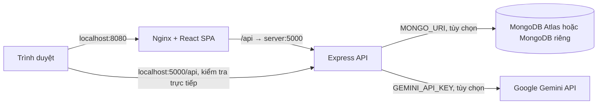

# Sơ đồ triển khai

## Docker



Compose hiện có hai service `web` và `server`, không tạo MongoDB. Khi chưa cấu hình database, API dùng danh mục demo; đăng ký và đặt đơn cần MongoDB. Với MongoDB ở máy host, cấu hình URI phù hợp từ trong container, chẳng hạn hostname `host.docker.internal` trên Docker Desktop.

Từ gốc repository:

```bash
docker compose -f docker/docker-compose.yml up --build -d
docker compose -f docker/docker-compose.yml ps
docker compose -f docker/docker-compose.yml logs
```

Mở http://localhost:8080 và kiểm tra http://localhost:5000/api/health. API trả `database: "demo"` hoặc `"mongodb"` để nhận biết chế độ. Dừng bằng `docker compose -f docker/docker-compose.yml down`.

## Local đầy đủ

```text
Trình duyệt → Vite (mặc định 5173) → /api proxy → Express (mặc định 5001)
                                                   ├─ MongoDB local (.local-data/)
                                                   └─ Gemini (tùy chọn)
```

`npm ci` rồi `npm run dev:full` tự chọn cổng trống, khởi động database local và bổ sung catalog khi chưa cấu hình MongoDB riêng. Địa chỉ thực tế được in trong terminal. Script nằm tại `setup/scripts/dev-full.mjs`. Nếu `.env` cấu hình MongoDB riêng, cần chủ động nạp catalog bằng `npm run catalog:import`.

## Cấu hình và thành phần bên ngoài

Tạo `scr/server/.env` từ `scr/server/.env.example` nếu dùng dịch vụ riêng. Các biến gồm `MONGO_URI`, `JWT_SECRET`, `GEMINI_API_KEY` và cấu hình ngân hàng/webhook nếu cần thanh toán chuyển khoản. Xem [hướng dẫn cài đặt](README.md) để biết điều kiện của từng tính năng.

Không kèm database khách hàng, API key, bộ cài Node/Docker hoặc MongoDB binary trong bản nguồn. Các phần mềm và nơi cài đặt được liệt kê ở [soft/README.md](../soft/README.md). Dữ liệu demo và quy trình tái lập nằm trong [demo-data/README.md](demo-data/README.md).
